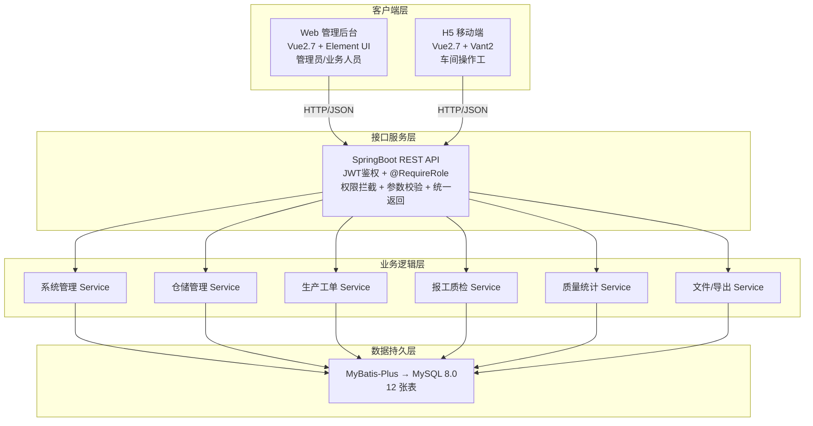
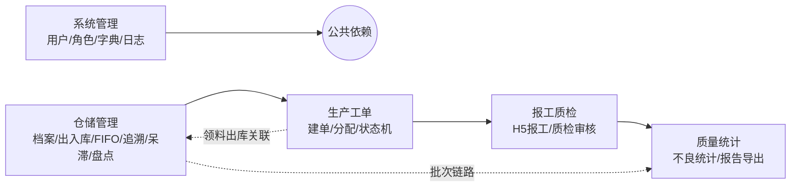
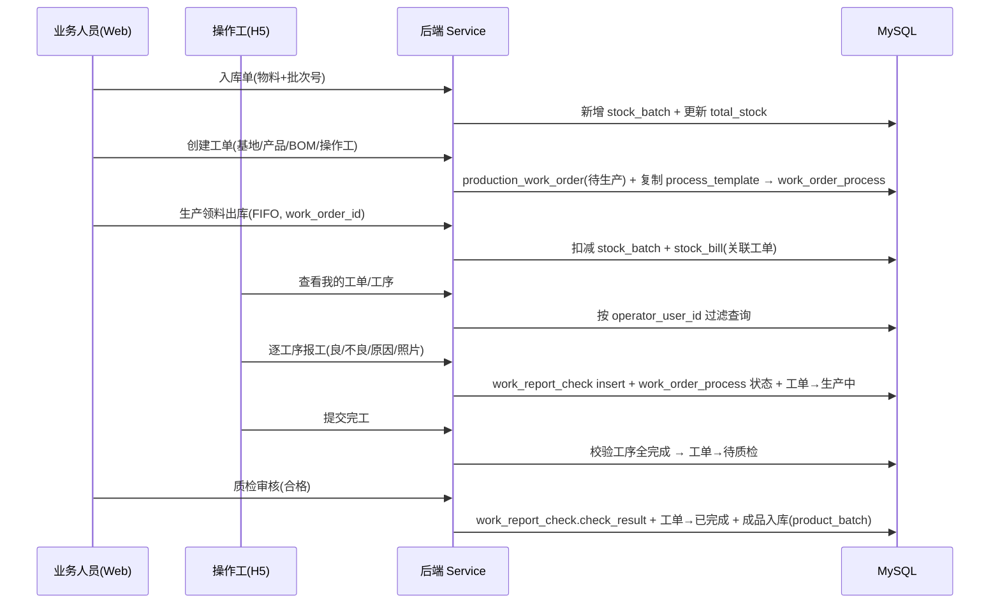
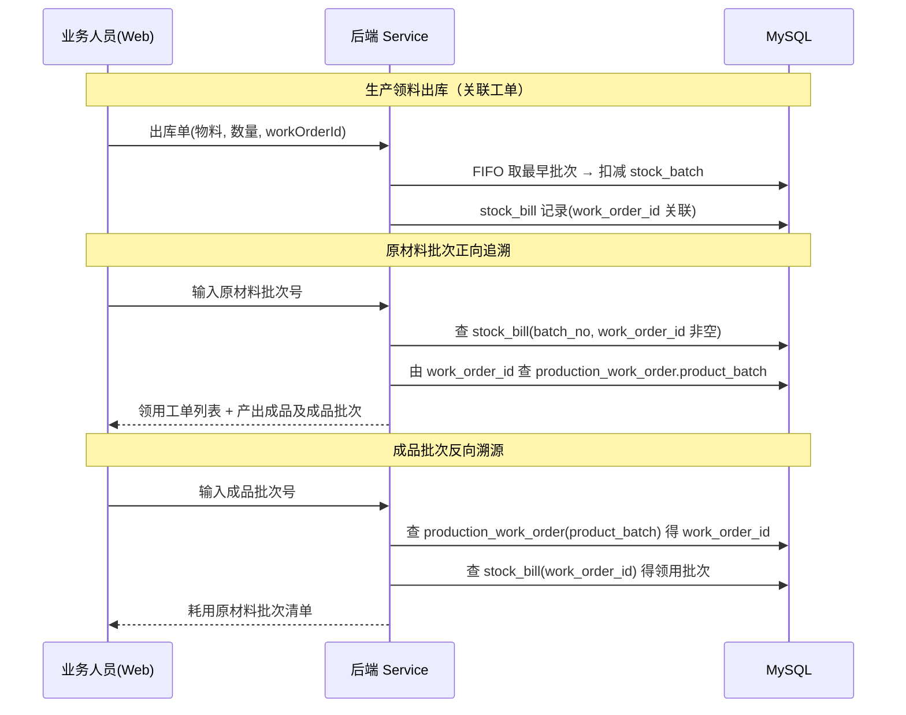
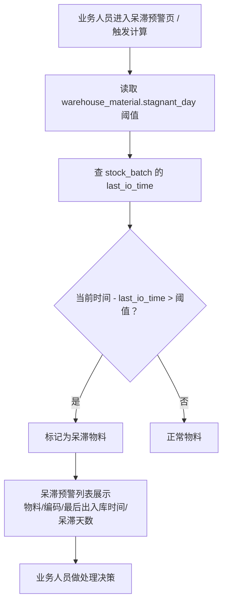
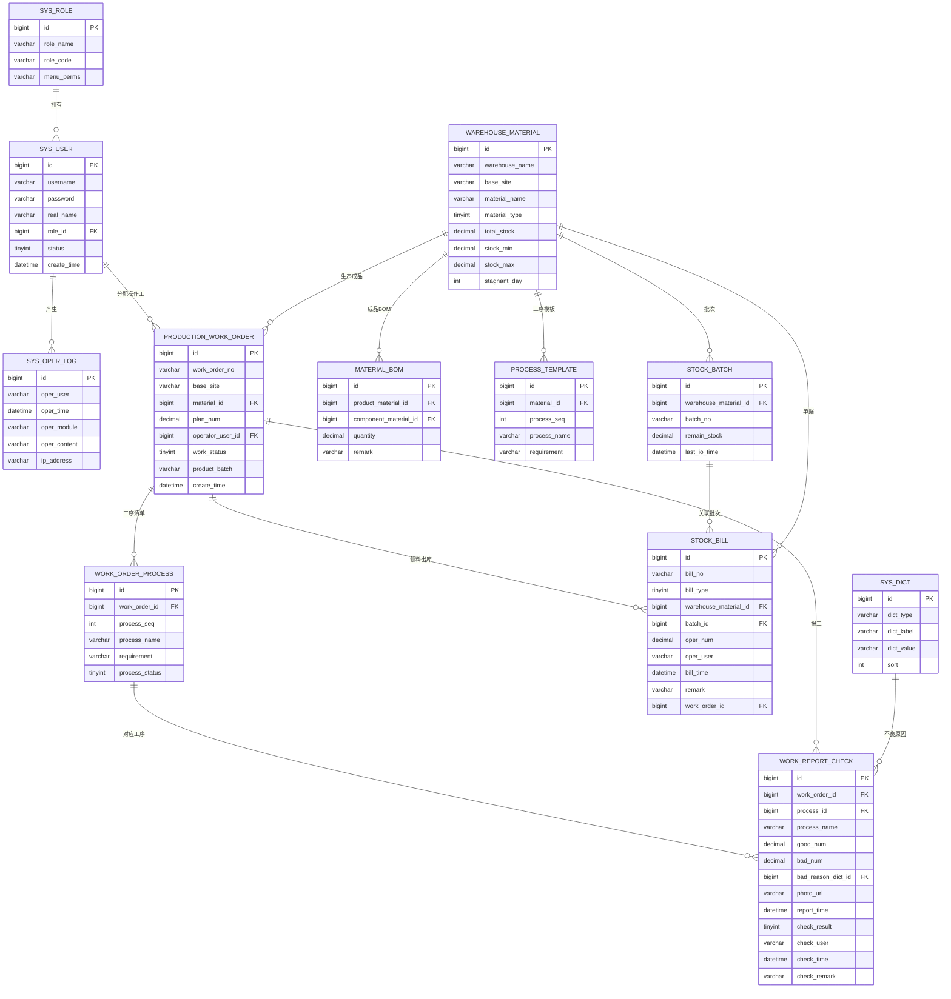
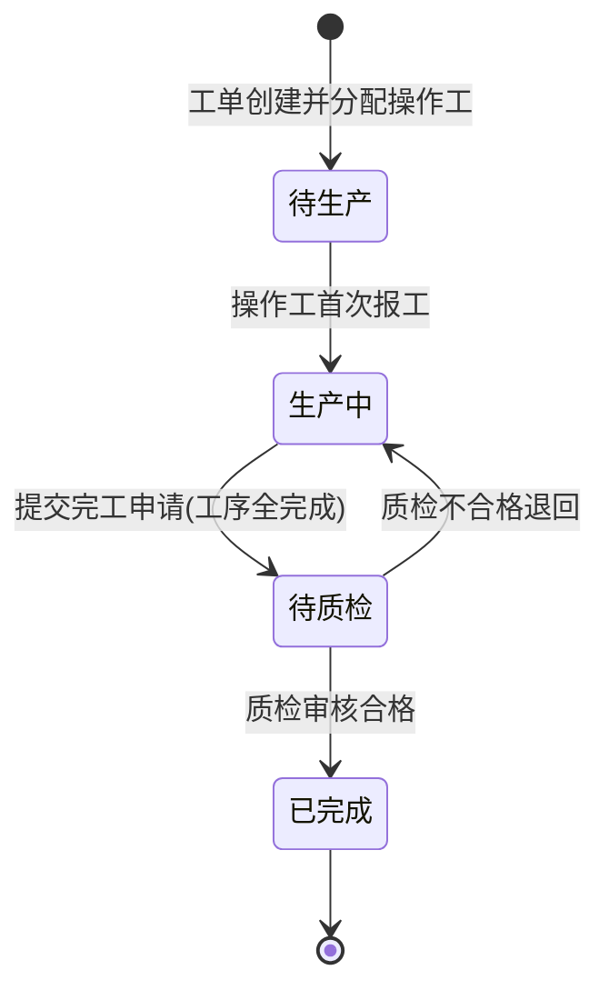
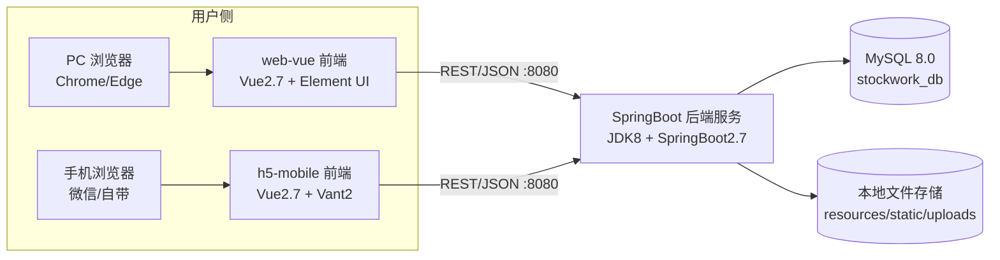

# DESIGN — 双基地仓储库存与生产报工管理系统（项目规划）

> 6A 阶段：Architect（架构）
> 版本：v1.0
> 日期：2026-10-20
> 状态：设计完成，待审批
> 上游：[CONSENSUS_双基地仓储库存与生产报工管理系统.md](file:///c:/Users/pc/Desktop/demo-6a/docs/双基地仓储库存与生产报工管理系统/CONSENSUS_双基地仓储库存与生产报工管理系统.md)

---

## 1 整体架构

### 1.1 四层架构图



> 关键：Web 与 H5 只在前端展示/路由不同，**调用完全相同的一套后端接口**。

### 1.2 模块依赖关系图



> 依赖倒序：仓储 → 工单 → 报工质检 → 质量统计；系统管理被全部模块公共依赖（鉴权/字典）。

---

## 2 分层设计与核心组件

| 层 | 组件 | 职责 |
|----|------|------|
| 客户端 | Web (views: login/system/warehouse/workorder/quality)、H5 (views: login/myWorkOrder/orderDetail/reportWork) | 展示 + 交互；axios 统一封装，路由守卫按角色过滤 |
| 接口层 | Controller（8 个）、Interceptor（鉴权/权限）、GlobalExceptionHandler、Knife4j | 接收请求、鉴权、参数校验、统一响应 |
| 业务层 | Service/impl（系统、仓储、工单、报工质检、统计、文件导出） | 业务规则、事务、状态机、FIFO、追溯算法 |
| 持久层 | Mapper（MyBatis-Plus）、Entity（12）、VO | 数据读写 |
| 基础设施 | config（跨域/MP/上传）、util（JWT/日期/Excel/文件）、exception | 横切能力 |

### 2.1 后端包结构（`com.project.stockwork`）

```
config / controller / service(→impl) / mapper / entity / vo / util / exception
resources: mapper(xml) / static(上传) / application.yml
```
Controller：Auth、System、Warehouse、Stock、Batch、WorkOrder、ReportCheck、Quality。

### 2.2 前端包结构

```
web-vue:   api / router(动态) / store(user,role,token) / views(login,system,warehouse,workorder,quality) / components / utils
h5-mobile: api / router / views(login,myWorkOrder,orderDetail,reportWork) / utils
```

---

## 3 接口契约定义

统一返回：`{ code: 200, msg: "成功", data: {...} }`；失败 `code≠200`。
路径：`/api/{module}/{action}`。分页返回 `data: { total, list }`。

### 3.1 认证与系统管理
| 接口 | 方法 | 路径 | 入参 | 出参 | 权限 |
|------|------|------|------|------|------|
| 登录 | POST | /api/auth/login | username,password | token,userInfo | 公开 |
| 登出 | POST | /api/auth/logout | — | — | 登录 |
| 用户列表 | GET | /api/system/user/list | 分页/条件 | total,list | ADMIN |
| 用户新增/编辑 | POST | /api/system/user/save | 用户信息 | — | ADMIN |
| 用户启/禁用 | POST | /api/system/user/status | id,status | — | ADMIN |
| 角色列表 | GET | /api/system/role/list | — | list | ADMIN |
| 角色权限保存 | POST | /api/system/role/perm | roleId,menus | — | ADMIN |
| 字典查询 | GET | /api/system/dict/list | dictType | list | 登录 |
| 字典维护 | POST | /api/system/dict/save | 字典项 | — | ADMIN |
| 操作日志 | GET | /api/system/log/list | 时间/操作人 | total,list | ADMIN |

### 3.2 仓储管理
| 接口 | 方法 | 路径 | 入参 | 出参 | 权限 |
|------|------|------|------|------|------|
| 仓库物料档案列表 | GET | /api/warehouse/list | 基地/类型 | total,list | 业务 |
| 档案新增/编辑 | POST | /api/warehouse/save | 档案 | — | 业务 |
| 入库单据创建 | POST | /api/stock/inBound | 基地,仓库,物料,数量,批次号,备注 | — | 业务 |
| 出库单据创建 | POST | /api/stock/outBound | ...,批次(可选，缺省FIFO),数量,workOrderId | — | 业务 |
| FIFO 推荐批次 | GET | /api/stock/fifoBatch | materialId | 批次列表(按入库升序) | 业务 |
| 原材料正向追溯 | GET | /api/batch/traceForward | batchNo | 工单列表+成品批次 | 业务 |
| 成品反向溯源 | GET | /api/batch/traceBackward | productBatch | 原料批次列表 | 业务 |
| 呆滞物料列表 | GET | /api/stock/stagnant | 阈值(可覆盖) | 呆滞物料列表 | 业务 |
| 呆滞阈值配置 | POST | /api/stock/stagnant/config | materialId,day | — | 业务 |
| 库存盘点 | POST | /api/stock/check | materialId,实盘数 | 差异结果 | 业务 |
| 库存台账导出 | GET | /api/stock/exportLedger | 条件 | Excel | 业务 |
| 入库/出库单据列表 | GET | /api/stock/bill/list | 类型/条件 | total,list | 业务 |

### 3.3 生产工单
| 接口 | 方法 | 路径 | 入参 | 出参 | 权限 |
|------|------|------|------|------|------|
| 工单创建 | POST | /api/workorder/save | 基地,产品,BOM,数量,操作工,成品批次 | — | 业务 |
| BOM 维护 | POST | /api/workorder/bom/save | productMaterialId,组件用量列表 | — | 业务 |
| 工序模板维护 | POST | /api/workorder/processTpl/save | materialId,工序清单 | — | 业务 |
| 工单列表 | GET | /api/workorder/list | 基地/状态/操作工 | total,list | 业务 |
| 工单详情 | GET | /api/workorder/detail | id | 工单+工序清单+报工汇总 | 业务/H5本人 |
| 工单进度监控 | GET | /api/workorder/progress | id | 工序报工明细+照片+良劣统计 | 业务 |

### 3.4 H5 报工与质检
| 接口 | 方法 | 路径 | 入参 | 出参 | 权限 |
|------|------|------|------|------|------|
| H5 登录 | POST | /api/auth/login | 同上（校验角色=操作工） | token | 操作工 |
| 我的工单列表 | GET | /api/report/myOrders | 状态 | total,list | 操作工 |
| 工单工序详情 | GET | /api/report/orderProcess | workOrderId | 工序清单+状态 | 操作工(本人) |
| 工序报工 | POST | /api/report/submit | workOrderId,processId,goodNum,badNum,badReasonId,photoUrl | — | 操作工(本人) |
| 提交完工 | POST | /api/report/finish | workOrderId | — | 操作工(本人) |
| 待质检列表 | GET | /api/reportCheck/todo | 条件 | total,list | 业务 |
| 质检审核 | POST | /api/reportCheck/audit | workOrderId,result,remark,badReasonId | — | 业务 |
| 文件上传 | POST | /api/file/upload | file | url | 登录 |

### 3.5 质量统计与导出
| 接口 | 方法 | 路径 | 入参 | 出参 | 权限 |
|------|------|------|------|------|------|
| 不良原因统计 | GET | /api/quality/stat | 时间范围,基地 | 分类聚合数据 | 业务 |
| 统计导出 | GET | /api/quality/stat/export | 同上 | Excel | 业务 |
| 质检报告导出 | GET | /api/quality/report/export | workOrderId | Word/PDF | 业务 |

---

## 4 数据流向图

### 4.1 入库 → 领料 → 报工 → 质检 → 成品（主业务流）


### 4.2 批次追溯链路
```
原材料批次 ──(stock_bill.work_order_id)──► 生产工单 ──(production_work_order.product_batch)──► 成品批次
正向：输入原料批次号 → 找出关联工单 → 输出成品及成品批次
反向：输入成品批次号 → 找出工单 → 找出领料出库单据 → 输出原料批次清单
```

### 4.3 批次追溯 / 生产领料子流程时序图



### 4.4 呆滞库存预警流程图



---

## 5 数据库 ER 关系图（12 张表）



> 关系说明：`work_order_id` 是打通"原材料批次 → 工单 → 成品批次"追溯链路的关键外键；`work_order_process` 承载工单级工序清单，`work_report_check` 逐工序对应一条报工记录。

---

## 6 工单状态机



> 状态流转**只在后端 Service 层硬编码**，前端只能调用接口，禁止直接修改 `work_status`。

---

## 7 异常处理策略

| 场景 | 处理 |
|------|------|
| 参数非法 | 全局 `GlobalExceptionHandler` 捕获校验异常，返回 `code=400, msg=...` |
| 未登录/无权限 | 拦截器返回 `code=401/403`，前端跳登录或提示 |
| 批次库存不足出库 | Service 抛业务异常，事务回滚，返回明确提示 |
| 工序未全完成提交完工 | Service 校验拦截，返回业务异常 |
| 非法工单状态跳转 | 状态机校验拦截，禁止前端直接改 status |
| 文件上传失败/超限 | 统一异常返回，限制类型与大小 |
| 事务一致性 | 出入库、工单状态流转、报工+工序状态 加 `@Transactional` |
| 并发扣减库存 | 批次扣减使用条件更新/行锁，防超卖 |

---

## 8 部署设计

### 8.1 部署架构图



### 8.2 环境与运行

- 开发：JDK8 + SpringBoot2.7 + Maven；Node.js（Vue2）；MySQL8.0。
- 演示（无需云服务器）：本地启动后端 → 运行 web-vue / h5-mobile → PC 浏览器访问 Web，手机浏览器访问 H5。
- MySQL：`CREATE DATABASE stockwork_db DEFAULT CHARACTER SET utf8mb4;`（提前手动执行）。

---

## 9 设计原则核对

- [x] 架构图清晰准确
- [x] 接口定义完整（含入参/出参/权限）
- [x] 与现有系统设计文档一致（四层架构 / 同一套接口 / 9 表基础上增 3 表）
- [x] 设计可行性验证（技术栈均为成熟方案）
- [x] 避免过度设计（保持单表、Excel/Word 用现成库）
