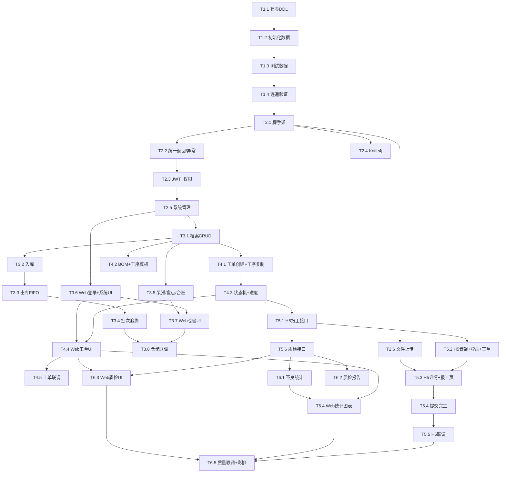

# TASK — 双基地仓储库存与生产报工管理系统（项目规划）

> 6A 阶段：Atomize（原子化）
> 版本：v1.0
> 日期：2026-10-20
> 状态：任务拆分完成，待审批
> 上游：[DESIGN_双基地仓储库存与生产报工管理系统.md](file:///c:/Users/pc/Desktop/demo-6a/docs/双基地仓储库存与生产报工管理系统/DESIGN_双基地仓储库存与生产报工管理系统.md)
> 说明：**本文件只做任务规划，不含任何代码实现。**

---

## 1 任务拆分总览

按依赖顺序 6 个 Phase，共 **34 个原子任务**（后端 20 / Web 前端 8 / H5 前端 6）。

| Phase | 名称 | 任务数 | 交付里程碑 |
|-------|------|--------|-----------|
| P1 | 数据库建表 + 初始化数据 | 4 | 12 表 + 初始化数据可查 |
| P2 | 后端框架 + 系统管理模块 | 6 | 三角色登录 + Knife4j + 权限 |
| P3 | 仓储管理模块 | 8 | 出入库/FIFO/追溯/呆滞/台账 |
| P4 | 生产工单模块 | 5 | 建单分配 + 状态机 + H5 可读 |
| P5 | H5 报工模块 | 6 | H5 报工闭环 |
| P6 | 质量管控 + 统计导出 | 5 | 质检闭环 + 图表 + 报告 |

---

## 2 原子任务清单

> 每任务格式：**编号 | 名称** → 输入契约 / 输出契约 / 实现约束 / 依赖

### Phase 1：数据库建表 + 初始化数据

**T1.1 | 建表 DDL 脚本**
- 输入：CONSENSUS 表结构清单（12 表）
- 输出：`sql/init_table.sql`（12 张表 DDL）
- 约束：utf8mb4；主键 id bigint 自增；BigDecimal→decimal(10,2)；不物理删除
- 依赖：无（起点）

**T1.2 | 初始化数据脚本**
- 输入：T1.1
- 输出：`sql/init_data.sql`（3 角色、字典：生产基地/不良原因、管理员账号）
- 约束：密码加密存储；字典项与需求一致
- 依赖：T1.1

**T1.3 | 测试数据脚本**
- 输入：T1.1/T1.2
- 输出：`sql/test_data.sql`（宁波/合肥仓库物料、操作工账号、BOM、工序模板、示例批次）
- 约束：数据覆盖演示路线，供 FIFO/追溯验证
- 依赖：T1.2

**T1.4 | 数据库连通性验证**
- 输入：T1.1~T1.3
- 输出：DBeaver/Navicat 执行三脚本无报错；管理员可登录
- 约束：`CREATE DATABASE stockwork_db`
- 依赖：T1.3

### Phase 2：后端框架 + 系统管理模块

**T2.1 | SpringBoot 脚手架**
- 输入：环境清单就绪（JDK8/Maven/MySQL）
- 输出：`backend/` 骨架（pom 依赖、application.yml、跨域配置、启动类）
- 约束：SpringBoot2.7.x + MyBatis-Plus3.5.x + Hutool + EasyExcel + Knife4j；密钥入 `.env`
- 依赖：T1.4

**T2.2 | 统一返回 + 全局异常**
- 输入：T2.1
- 输出：`CommonResult<T>` + `GlobalExceptionHandler`
- 约束：`{code,msg,data}`；失败 code≠200
- 依赖：T2.1

**T2.3 | JWT 登录认证 + 权限拦截器**
- 输入：T2.2
- 输出：`/api/auth/login` 返回 token；`@RequireRole` 拦截器；LoginUser 上下文
- 约束：三角色区分；H5 仅操作工可登；未登录拒绝
- 依赖：T2.2、T1.2

**T2.4 | Knife4j 集成**
- 输入：T2.1
- 输出：`http://localhost:8080/doc.html` 可访问全部接口
- 约束：分组展示
- 依赖：T2.1

**T2.5 | 系统管理模块（用户/角色/字典/日志）**
- 输入：T2.3
- 输出：8~10 个 REST 接口（见 DESIGN 3.1）；操作日志 AOP 记录入库/出库/工单关键操作
- 约束：用户唯一；禁用禁登；日志只 insert
- 依赖：T2.3

**T2.6 | 文件上传通用接口**
- 输入：T2.1
- 输出：`/api/file/upload` 返回 `/uploads/xxx.jpg`
- 约束：限制类型/大小；本地存储
- 依赖：T2.1

### Phase 3：仓储管理模块（后端 5 + Web 前端 3）

**T3.1 | 仓库物料档案 CRUD**
- 输入：T2.5
- 输出：`/api/warehouse/list|save`（单表 warehouse_material）
- 约束：基地/类型/上下限/呆滞阈值维护
- 依赖：T2.5

**T3.2 | 入库管理（含批次）**
- 输入：T3.1
- 输出：`/api/stock/inBound` → 新增 stock_batch + 更新 total_stock
- 约束：必录批次号；@Transactional；单据可作废不可删
- 依赖：T3.1

**T3.3 | 出库管理（FIFO）**
- 输入：T3.2
- 输出：`/api/stock/outBound`、`/api/stock/fifoBatch`；扣减批次库存
- 约束：FIFO 按入库升序；批次库存不足拦截；支持 work_order_id（生产领料）
- 依赖：T3.2

**T3.4 | 批次双向追溯**
- 输入：T3.3
- 输出：`/api/batch/traceForward|traceBackward`（+导出）
- 约束：依赖 stock_bill.work_order_id 与 product_batch 链路
- 依赖：T3.3、T4.1（工单表）—— 注：查询接口可在 T4.1 后联调

**T3.5 | 呆滞预警 + 库存盘点 + 台账导出**
- 输入：T3.1
- 输出：`/api/stock/stagnant|check|exportLedger`
- 约束：以 stock_batch.last_io_time 计算呆滞；EasyExcel 导出
- 依赖：T3.1

**T3.6 | Web：登录页 + 系统管理 UI**
- 输入：T2.5（接口）
- 输出：`web-vue` 项目骨架 + login + system（用户/角色/字典/日志）
- 约束：Vue2.7+Element UI；axios 拦截器带 token；路由守卫
- 依赖：T2.5

**T3.7 | Web：仓储模块 UI**
- 输入：T3.1~T3.5
- 输出：warehouse（档案/单据/批次追溯/呆滞预警/台账）
- 约束：FIFO 批次下拉；追溯结果可导出
- 依赖：T3.5、T3.6

**T3.8 | 仓储模块联调验收**
- 输入：T3.7
- 输出：完整出入库→FIFO→追溯→呆滞→台账 跑通
- 约束：用 T1.3 测试数据验证追溯链路非空
- 依赖：T3.4、T3.7

### Phase 4：生产工单模块（后端 3 + Web 前端 2）

**T4.1 | 工单创建 + 工序清单复制**
- 输入：T3.2、T1.3
- 输出：`/api/workorder/save`（建单并复制 process_template → work_order_process）
- 约束：初始状态待生产；分配操作工；生成/绑定 product_batch
- 依赖：T3.1

**T4.2 | BOM + 工序模板维护**
- 输入：T4.1
- 输出：`/api/workorder/bom/save`、`/api/workorder/processTpl/save`
- 约束：BOM 表达成品→组件用量；模板表达工序顺序/要求
- 依赖：T3.1

**T4.3 | 工单状态机 + 进度聚合**
- 输入：T4.1
- 输出：`/api/workorder/list|detail|progress`；Service 层状态机校验
- 约束：待生产→生产中→待质检→已完成；非法跳转拦截；仅 Service 可改状态
- 依赖：T4.1

**T4.4 | Web：工单管理 + 进度监控 UI**
- 输入：T4.3
- 输出：workorder（列表筛选/建单/BOM工序模板/进度监控）
- 约束：建单页可选 BOM/工序模板/操作工
- 依赖：T3.6、T4.3

**T4.5 | 工单模块联调验收**
- 输入：T4.4
- 输出：建单→分配→H5 可读→状态流转正确
- 约束：非法状态跳转被拦截
- 依赖：T4.4、T5.2

### Phase 5：H5 报工模块（后端 3 + H5 前端 3）

**T5.1 | H5 报工后端接口**
- 输入：T2.3、T4.1
- 输出：`/api/report/myOrders|orderProcess|submit|finish`
- 约束：仅本人工单；不良>0 必选原因；逐工序报工；提交完工校验工序全完成并锁定记录
- 依赖：T4.1

**T5.2 | H5 项目骨架 + 登录 + 我的工单**
- 输入：T2.3、T5.1
- 输出：`h5-mobile` 骨架 + login + myWorkOrder（按状态筛选）
- 约束：Vue2.7+Vant2；仅操作工角色可登
- 依赖：T2.5、T5.1

**T5.3 | H5：工单详情 + 工序报工页**
- 输入：T5.1
- 输出：orderDetail（工序要求）+ reportWork（进度/照片上传/良劣/原因）
- 约束：手机适配；Vant Uploader
- 依赖：T5.2、T2.6

**T5.4 | H5：提交完工**
- 输入：T5.3
- 输出：finish 交互 + 状态反馈
- 约束：全部工序完成才可提交
- 依赖：T5.3

**T5.5 | H5 报工联调验收**
- 输入：T5.4
- 输出：操作工全流程跑通，Web 端状态变"待质检"
- 约束：真机/模拟器验证一次
- 依赖：T5.4

**T5.6 | 质检后端接口（报工质检）**
- 输入：T5.1
- 输出：`/api/reportCheck/todo|audit`
- 约束：仅待质检可审；整单审核；不合格退回生产中
- 依赖：T5.1

### Phase 6：质量管控 + 统计导出（后端 2 + Web 前端 3）

**T6.1 | 不良原因分类统计接口**
- 输入：T5.6
- 输出：`/api/quality/stat`（按时间+基地聚合报工/质检不良）、`/export`
- 约束：数据源为字典不良原因；EasyExcel 导出
- 依赖：T5.6

**T6.2 | 质检报告导出接口**
- 输入：T5.6
- 输出：`/api/quality/report/export`（Word/PDF）
- 约束：仅合格工单可导出；套用报告模板
- 依赖：T5.6

**T6.3 | Web：质检审核 UI**
- 输入：T5.6、T6.2
- 输出：quality 质检审核页（查看报工/照片/不良→填结果→导出报告）
- 约束：待质检列表
- 依赖：T4.4、T5.6

**T6.4 | Web：不良统计图表 UI**
- 输入：T6.1
- 输出：quality 统计页（ECharts 饼图/柱状图 + 导出）
- 约束：时间/基地筛选
- 依赖：T6.1、T4.4

**T6.5 | 质量模块联调验收 + 演示路线彩排**
- 输入：T6.3、T6.4
- 输出：质检闭环 + 图表正确 + 报告可导出；按演示路线完整彩排
- 约束：按 CONSENSUS 5.1 演示路线走通
- 依赖：T6.3、T6.4、T5.5

---

## 3 任务依赖图

> 并行提示：`T2.4/T2.6` 可与 `T2.5` 并行；`T3.6` Web 前端可在 `T2.5` 后与后端 P3 并行；`T3.7` 与后端 P4 可部分并行。

---

## 4 质量门控核对

- [x] 任务覆盖完整需求（P1~P6 对齐 CONSENSUS 功能清单）
- [x] 依赖关系无循环
- [x] 每个任务可独立验证（均有输出契约）
- [x] 复杂度评估合理（单任务粒度为一次可交付）
- [x] 未含代码实现（仅规划）

> 进入 Approve（审批）阶段：输出检查清单，等待用户确认后**另行启动开发**。
